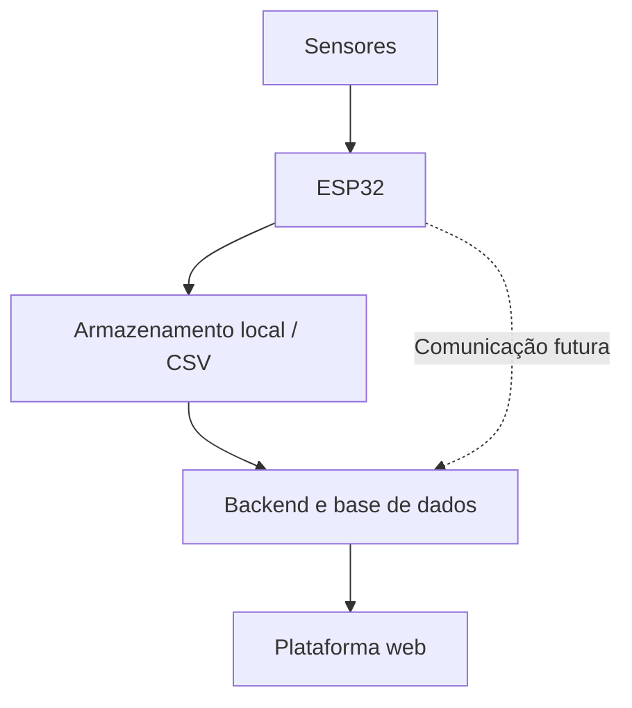

# Apiário Tech

> Plataforma IoT para monitorização e gestão de apiários, concebida para transformar leituras recolhidas nas colmeias em informação útil, histórico, alertas e registos de intervenção.

**Estado do projeto:** planeamento e consolidação do protótipo  
**Versão documental:** 0.1.0  
**Última atualização:** 21 de julho de 2026

## Visão geral

O Apiário Tech pretende apoiar o acompanhamento das colmeias através da recolha periódica de dados ambientais e operacionais. O sistema deverá funcionar num contexto de campo, com alimentação por energia solar e possibilidade de ausência temporária de ligação à Internet.

O projeto inclui três componentes principais:

1. **Firmware:** executado no ESP32 para leitura, validação e armazenamento da telemetria.
2. **Backend:** API, regras da aplicação e persistência dos dados.
3. **Plataforma web:** gestão de apiários e colmeias, consulta de dados, alertas e intervenções.

## Objetivos

- acompanhar o estado atual e a evolução das colmeias;
- reduzir a dependência de visitas exclusivamente para recolha de informação;
- guardar um histórico fiável das leituras e intervenções;
- detetar situações anómalas através de alertas simples;
- criar uma base técnica evolutiva para comunicação remota e funcionalidades inteligentes.

## MVP

A primeira versão utilizável deverá permitir:

- criar contas de utilizador e controlar o acesso;
- registar apiários e colmeias;
- importar leituras produzidas pelo ESP32 em ficheiro CSV;
- preparar a receção futura das mesmas leituras através de uma API;
- consultar o estado atual, o histórico e gráficos;
- configurar e visualizar alertas básicos;
- registar inspeções, alimentação, tratamentos e observações.

O reconhecimento da Vespa velutina e outras funcionalidades de inteligência artificial não fazem parte do MVP inicial.

## Protótipo físico

O protótipo base inclui atualmente:

- ESP32;
- BME280 para temperatura, humidade e pressão no exterior;
- duas sondas DS18B20 para temperatura dos ninhos;
- RTC DS3231 para data e hora;
- ecrã OLED;
- módulo microSD;
- células de carga e módulo HX711;
- alimentação solar e bateria no apiário.

O estado de integração e os pontos que ainda necessitam de validação estão registados em [Estado atual do protótipo](docs/02-estado-atual-prototipo.md).

## Arquitetura inicial



O formato da telemetria será comum à importação de CSV e ao envio automático futuro, evitando a duplicação de regras e formatos.

## Organização prevista

```text
apiario-tech/
├── docs/          Documentação funcional e técnica
├── firmware/      Código executado no ESP32
├── backend/       API e regras da aplicação
├── frontend/      Plataforma web
├── database/      Modelo e scripts da base de dados
└── tests/         Testes automatizados e evidências de validação
```

As pastas de implementação serão criadas à medida que cada componente for iniciado, evitando ficheiros vazios apenas para representar diretórios.

## Documentação

- [Visão e âmbito](docs/01-visao-e-ambito.md)
- [Estado atual do protótipo](docs/02-estado-atual-prototipo.md)

## Próximos marcos

1. inventariar o hardware, o código e as ligações existentes;
2. estabilizar BME280, DS18B20, OLED, RTC e microSD;
3. testar e calibrar uma balança completa com HX711;
4. definir o contrato de telemetria e o formato CSV;
5. implementar o primeiro percurso completo: ESP32 → CSV → base de dados → dashboard;
6. testar o sistema nas duas colmeias durante um período prolongado.

## Segurança

Credenciais, palavras-passe, chaves de API, dados de acesso à rede e outros segredos nunca deverão ser guardados no repositório. O controlo de acesso, a validação dos dados, os registos de auditoria e as cópias de segurança serão tratados desde o início do desenvolvimento.

## Licença

Ainda não foi atribuída uma licença ao projeto. Até existir uma decisão formal, a ausência de licença não autoriza a cópia, alteração ou distribuição do conteúdo.
